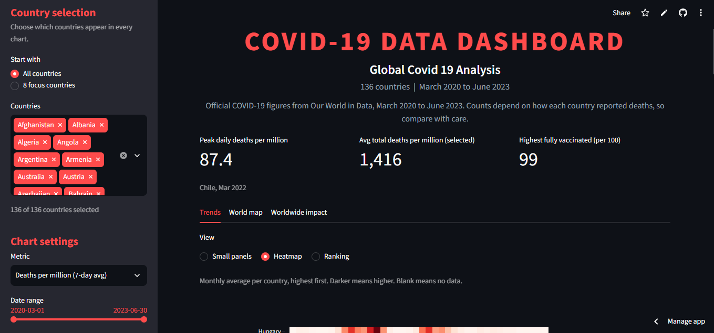
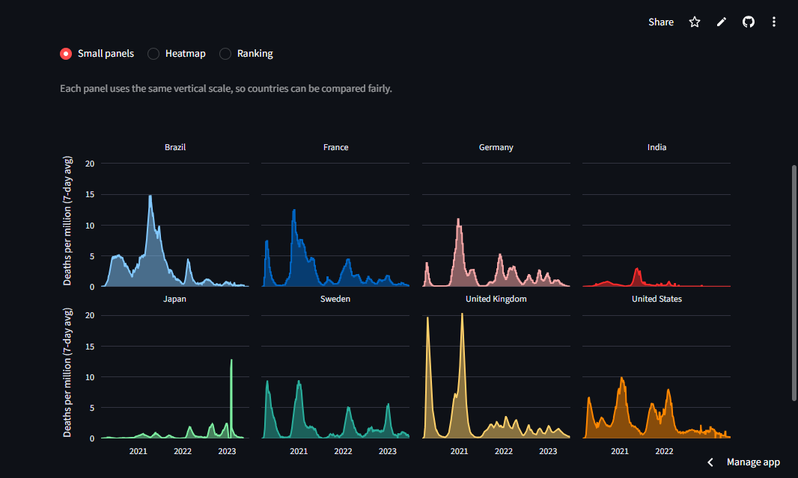
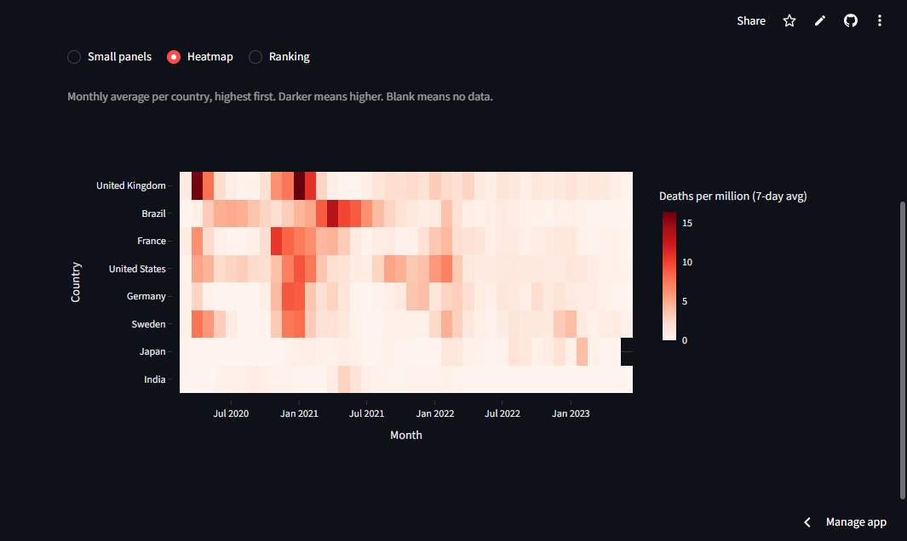
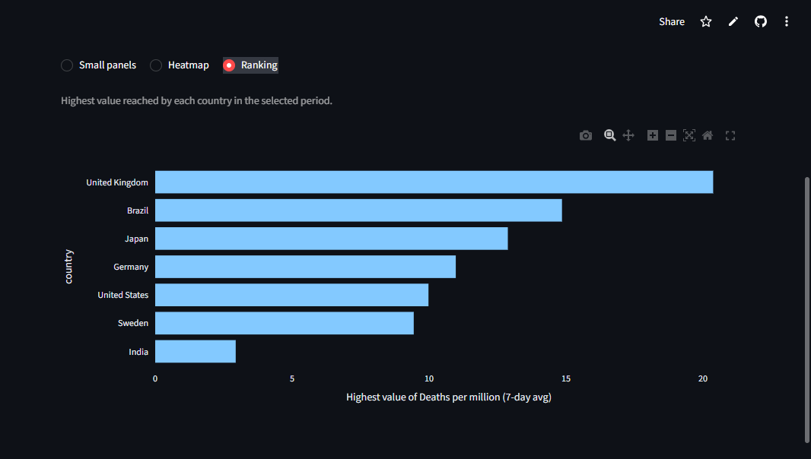
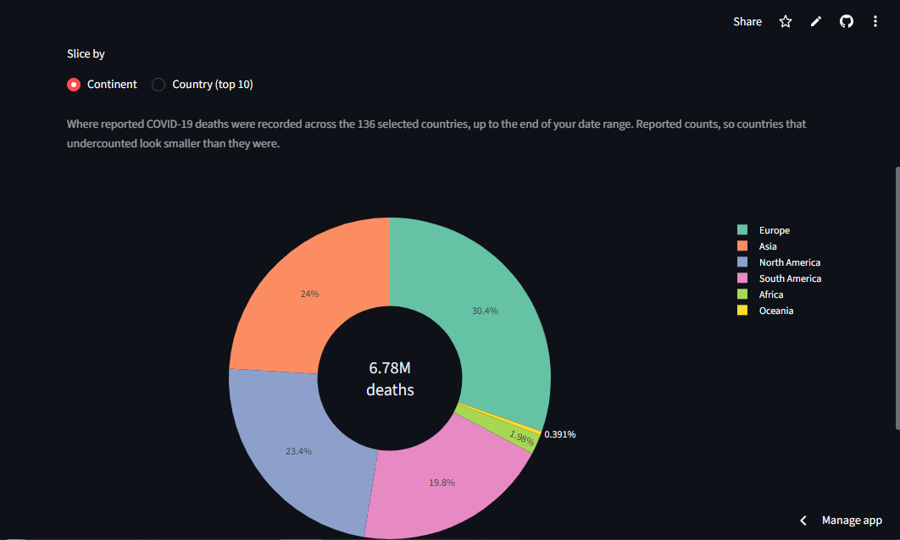
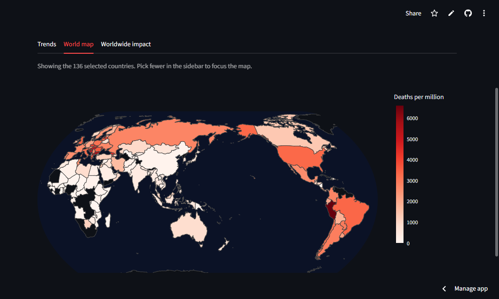

<div align="center">

# Global COVID-19 Analysis

**An interactive dashboard and analysis of reported COVID-19 deaths, cases and vaccination across 136 countries, March 2020 to June 2023.**

[](https://covid-global-analysis.streamlit.app)


**[Open the live dashboard](https://covid-global-analysis.streamlit.app)**

</div>



## Overview

This project compares how COVID-19 played out in different countries and asks three questions:

1. How did the waves differ across countries?
2. What happened to deaths after countries reached 30% full vaccination, and does that result hold up?
3. What explains differences in total deaths per million between countries?

The analysis was built in Jupyter notebooks, and the results are explored in a Streamlit dashboard.

## Dashboard features

| Area | What you can do |
|---|---|
| **Country selection** | Start with all 136 countries or 8 focus countries (Brazil, Germany, India, Japan, South Africa, Sweden, UK, USA), then add or remove any country |
| **Metric** | Deaths per million, cases per million, fully vaccinated per 100, or stringency index (all 7-day averages where applicable) |
| **Trends** | Small panels with a shared scale, a heatmap of monthly averages, or a ranking of peak values |
| **World map** | Deaths per million for the selected countries |
| **Worldwide impact** | Share of reported deaths by continent, or by the 10 countries with the most deaths |
| **Date range** | Zoom into any period between March 2020 and June 2023 |

<p align="center">
  
  
</p>
<p align="center">
  
  
</p>
<p align="center">
  
</p>

<p align="center"><sub>Top: small panels on a shared scale and the monthly heatmap, shown here for Brazil, France, Germany, India, Japan, Sweden, the UK and the US (any countries can be selected in the dashboard). Middle: ranking of peak values (Japan ranks third mainly because of a single February 2023 spike that may be a reporting artifact), and the share of reported deaths by continent across 136 countries (about 6.78 million reported deaths in total). Bottom: world map of deaths per million, where countries with no data in the model appear dark.</sub></p>

## Key findings

**1. The waves differed sharply by country.**
The UK had the highest peaks, about 20 deaths per million per day (7-day average) in both April 2020 and January 2021. Brazil had the largest sustained wave in spring 2021, peaking at about 15. India's reported curve stays low, but see the limitations below.

**2. Deaths fell after 30% vaccination, but the result is not robust.**
Comparing the 90 days before and after each country reached 30% fully vaccinated (with a 28-day lag), average daily deaths fell by 47% to 79% in 7 of 8 focus countries. India rose by 26%. The picture changes with the threshold:

| Threshold | Result |
|---|---|
| 20% fully vaccinated | Deaths fell in 7 of 8 countries (India +12%) |
| 30% fully vaccinated | Deaths fell in 7 of 8 countries (India +26%) |
| 50% fully vaccinated | Deaths rose in Germany, Sweden, the UK and the US, because the "after" windows fall in the Delta and Omicron waves |

Deaths were also already falling before day zero in several countries, so this comparison mostly reflects the timing of waves and variants. It should be read as descriptive, not as an estimate of vaccine effectiveness.

**3. Age is the strongest predictor of total deaths per million.**
A cross-country regression (137 countries, R² = 0.52) found:

| Predictor | Association with deaths per million | p-value |
|---|---|---|
| Median age | +166 per extra year | < 0.001 |
| Peak fully vaccinated (per 100) | -13 per point | 0.006 |
| Hospital beds per 1,000 | -109 per bed | 0.044 |
| GDP per capita (log) | not significant | 0.27 |

Comparing actual with predicted totals, Peru (+5,637), Brazil (+1,776) and the US (+1,092) recorded far more deaths than the model expects, and Japan (-2,221) far fewer. A lower figure than predicted can mean real success or undercounting, so these gaps are questions to investigate rather than verdicts. This analysis lives in `notebooks/04_drivers.ipynb`.

## What this means

- **Raw death counts are a weak way to rank countries.** Undercounting, uneven reporting and very different age structures all change the picture, so none of them can be ignored.
- **Age structure explains far more than income.** Across 137 countries, median age was the strongest predictor of deaths per million, while GDP added little once age was included, so comparisons should adjust for age before judging how a country "performed".
- **Before/after vaccination comparisons are unreliable on their own.** The result flipped at a higher threshold because it mostly reflects when waves and variants hit, so judging vaccine impact needs methods that account for timing.
- **Use the dashboard to explore, not to rank.** It is best for spotting patterns and countries worth investigating, such as Peru and Japan against the model, not for deciding who handled the pandemic best.
- **Next step:** excess mortality data would give a fairer cross-country comparison than reported deaths.

## Limitations

- **Reported deaths only.** Countries count deaths differently, and undercounting is widespread. India's low reported curve is widely thought to understate the real toll. Excess mortality would be a better comparison.
- **Uneven end dates.** Germany stops reporting deaths in mid-2023, and South Africa and Japan stop earlier (January and May 2023). Each country is cut off at its last real reporting date, with 30 June 2023 as the latest.
- **Possible reporting artifacts.** Japan's February 2023 spike is in the source data. Chile's March 2022 peak of 87.4 per million is far above other countries and looks like a reporting catch-up. It has not been verified.
- **Sparse and missing data.** About 55% of days have no stringency value, and some countries have very few vaccination records (Sweden has about 114). Gaps in these series are visually connected in the charts.
- **Association, not causation.** Variants, seasonality, prior infection and testing differences all confound the results. The regression dropped 24 of 161 countries for missing predictors and can predict negative deaths for very young populations. A log-transformed outcome would fix that.

## Project structure

```
covid-global-analysis/
├── app.py                  # Streamlit dashboard
├── requirements.txt        # Dependencies for the dashboard
├── data/
│   ├── covid_trend.csv     # Cleaned daily data for 136 countries
│   ├── country_summary.csv # One row per country (regression inputs and results)
│   └── covid_focus.csv     # Cleaned data for the 8 focus countries
├── notebooks/
│   ├── 01_load_clean.ipynb # Load and clean the raw data
│   ├── 02_waves.ipynb      # Wave comparison and data-quality checks
│   ├── 03_vaccination.ipynb# Before/after vaccination analysis and sensitivity tests
│   └── 04_drivers.ipynb    # Cross-country regression and over/under-performers
└── images/                 # Screenshots used in this README
```

## Run it locally

```bash
git clone https://github.com/gunashekar751/covid-global-analysis.git
cd covid-global-analysis
pip install -r requirements.txt
streamlit run app.py
```

To re-run the notebooks, also install `jupyter`, `numpy`, `scipy`, `statsmodels` and `matplotlib`, then download the raw dataset (about 190 MB, not stored in this repo) from [Our World in Data](https://catalog.ourworldindata.org/garden/covid/latest/compact/compact.csv) and save it as `data/owid_raw.csv`.

## Data source

[Our World in Data](https://ourworldindata.org/coronavirus) COVID-19 dataset, which compiles figures from national and international sources including the Oxford COVID-19 Government Response Tracker (stringency index).

## Author

Built by **Guna Shekar** · [GitHub](https://github.com/gunashekar751)
